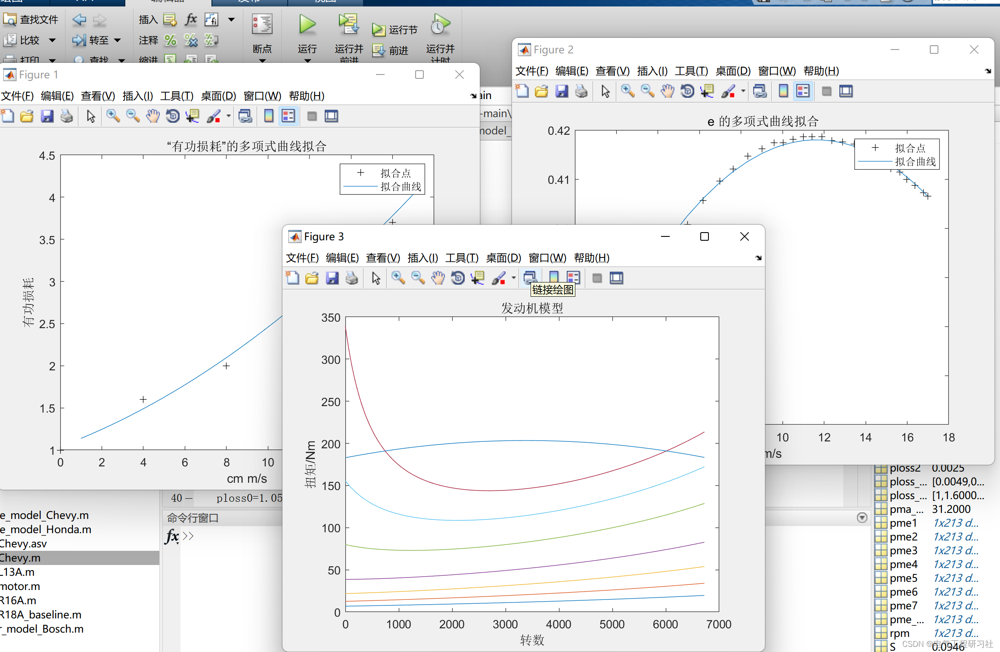
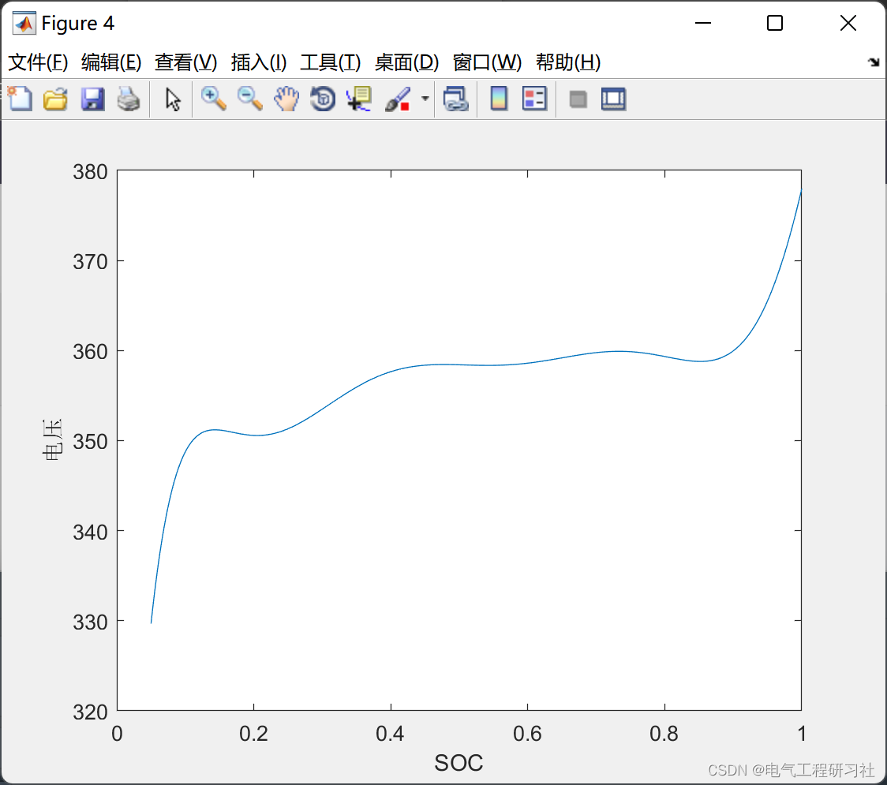
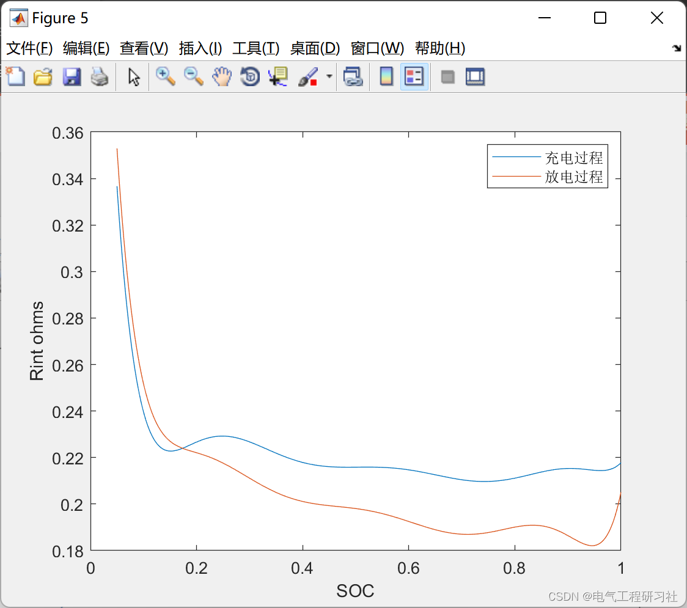
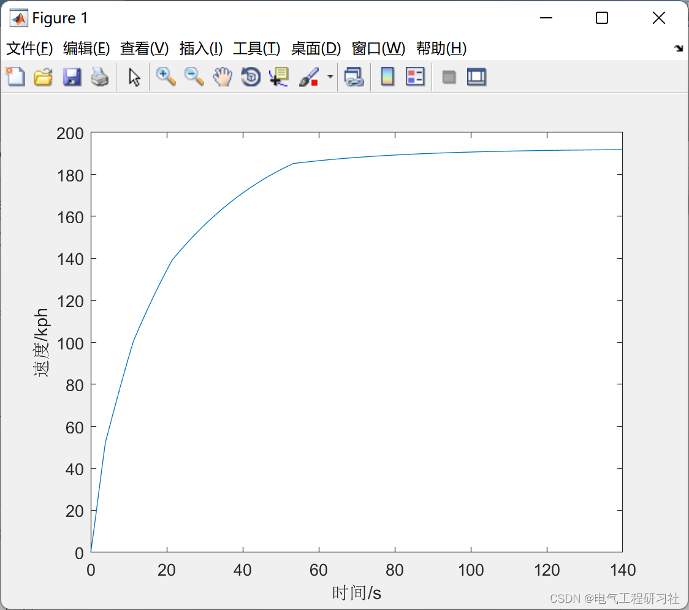
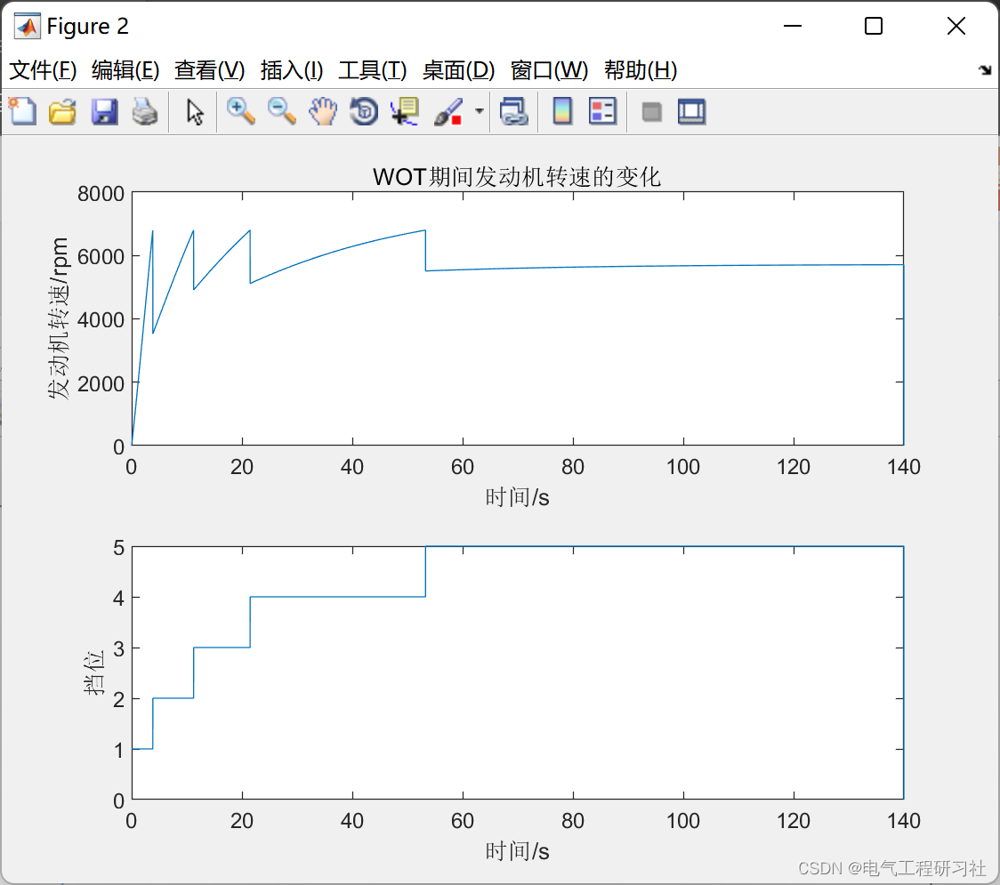
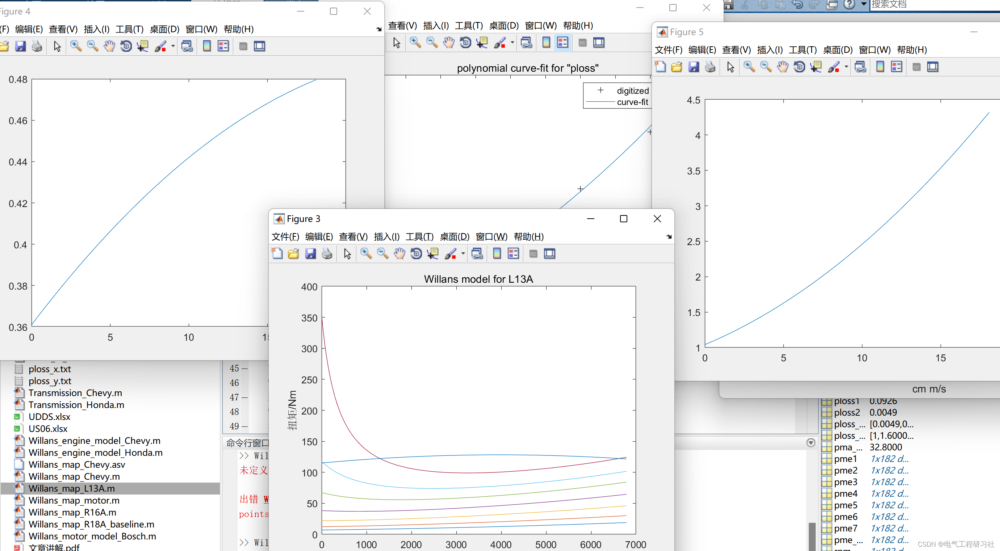
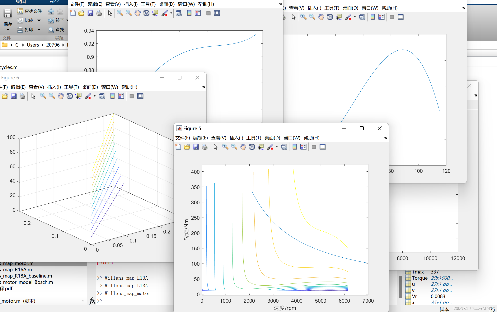
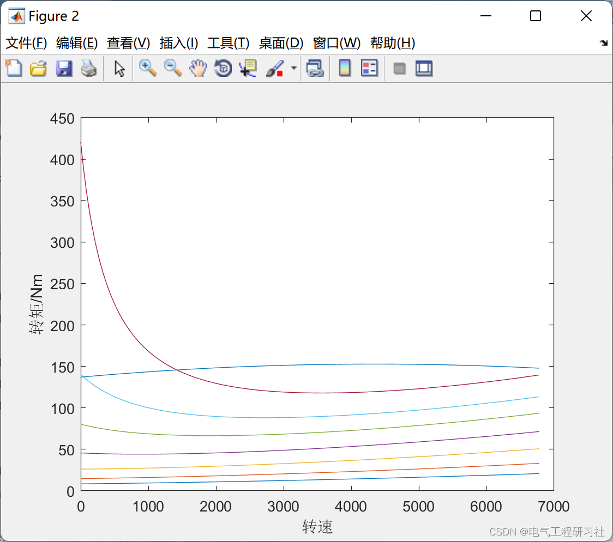
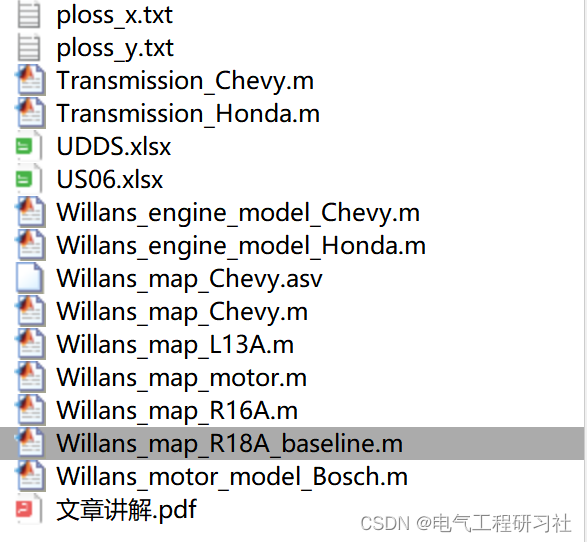

# Battery Electric Vehicle (BEV) Optimized Scheduling (Matlab Code Implementation)

​  
📋📋📋This article is organized as follows: ⛳️⛳️⛳️​Contents 1. Overview 2. Mathematical Model 3. Simulation Results 4. MATLAB Code + Data + Article Explanation 5. Final Thoughts 1. Overview The purpose of this article is to model and design the power system for PHEV, involving finding the required power and energy consumption for motor vehicles, traditional vehicles, and fully electric vehicles, and optimizing the size of components. The engine, motor, battery pack, and other components are modeled individually, then combined into a complete power system.
2. Mathematical Models: The vehicle itself is a very complex system. To model its energy consumption behavior, it is considered as an object that needs to overcome resistance in straight-line motion, hence the required force is referred to as traction force. This type of model is known as the longitudinal vehicle model.
Detailed mathematical models and flowcharts are available in Part 4.
3 Simulation results editing
Editor
Editor
Editor
Editor
Editor
Editor
4. Matlab code + data + article explanation. This article only showcases a part of the code, all codes can be found in:
Editor
5. Endnotes: The references to theoretical literature are from online sources, and if any infringement is found, please contact the blogger for removal.
​  

## Images

<!-- PAYMENT_BLOCK -->

## Get this dataset

- Payment link (Stripe): [Buy now](https://buy.stripe.com/3cs8yP7sY87d0vu9AB)
- Payment QR code: 

<!-- /PAYMENT_BLOCK -->
